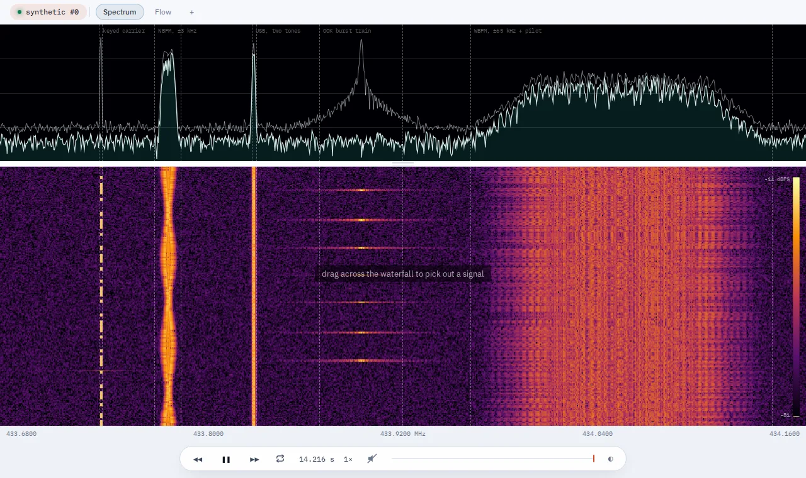

# SDR Flex

A modern, extensible signal analysis toolkit.

## Try It

The browser version runs at **https://livethisdream.github.io/sdr-flex/** with nothing
to install. It opens on a synthetic scene of several signals. Right-click or long-press
the source chip in the top left to open one of fourteen example captures, and drag across
the waterfall to select a signal and choose what to do with it.



The browser version runs the DSP, the demodulators, and the decoders that ship with the
client. The external decoders (rtl_433, direwolf, dump1090, and others), live radios, and
a capture library need the server; see [server/README.md](server/README.md).

**Thesis:** you start at the spectrum and drill in. Every time you drag a box on a
waterfall, pick a demodulator, or attach a decoder, the tool builds a GNU Radio
flowgraph behind you. You never author a flowgraph — you get one.

Two constraints shape everything else:

- **Reuse over rewrite.** The field's best decoders already exist. `rtl_433` (250+ ISM
  protocols), `multimon-ng`, `dump1090`, `direwolf`, `dsd`, and the whole GNU Radio OOT
  ecosystem are reachable as plugins for ~20 lines of manifest each. See [reuse](docs/07-reuse.md).
- **Friction is a correctness property.** Six interactions and under 900 px of pointer
  travel from cold launch to decoded bits. 50 ms from dragging a tuner to the child
  spectrum moving. Under 4 ms of frame jitter. These are budgets in CI, not
  aspirations. See [UI principles](docs/08-ui-principles.md).
- **It is an exploratory tool, so nothing is only automatic.** Every derived value —
  and the choice of decoder itself — carries an explicit auto/manual state, and auto
  always shows the evidence it reasoned from.

## Run It Yourself

The full tool, with the server, every external decoder, and GNU Radio, is one image:

```sh
docker run --rm -p 127.0.0.1:8722:8722 -e SDRFLEX_CAPTURES=/app/examples \
  ghcr.io/livethisdream/sdr-flex
```

Then open http://localhost:8722. The `SDRFLEX_CAPTURES` setting points the library at the
example captures in the image. To open your own instead, drop that setting and mount a
directory: `-v "$PWD/captures:/captures:ro"`. Saved sessions are lost with the container
unless you also add `-v sdrflex-sessions:/sessions`.

A Pluto works with no extra flags, because it is a network device at `192.168.2.1`. An
RTL-SDR is a USB device and needs `--device /dev/bus/usb`. The image is amd64 only.

The server has no authentication. The command above publishes it on this machine only;
do not publish it on a network you share with anyone else. [server/README.md](server/README.md)
covers running it on a box, over a tailnet, and with Docker Compose.

### With Your Own GNU Radio

If you already have GNU Radio, you do not need the image. Clone this repository and run
the server with Node 22 or newer:

```sh
node seed-captures.mjs
node server/main.js
```

The server looks for GNU Radio when it starts, first through `python3` and then in
radioconda's default location, and the startup lines say which one it found. If yours is
somewhere else, point the server at the Python it was built for:

```sh
SDRFLEX_GR_PYTHON=/opt/gnuradio/bin/python3 node server/main.js
```

With no GNU Radio, the server falls back to the built-in JavaScript engine and says so.
This has been checked on Linux with GNU Radio 3.10.9 from Ubuntu's packages and 3.10.12
from radioconda. Windows outside WSL has not been tried yet. The external decoders are
separate programs, and [server/README.md](server/README.md#decoders) covers installing
each one.

## Why another one

| Tool | What it gets right | What we take, what we fix |
|---|---|---|
| **GQRX** | Dead-simple workflow: open, tune, listen | Take the workflow. Fix: one demod chain, no extensibility, features bolted on |
| **URH** | Best-in-class decoding and bit-level analysis | Take the analysis views and annotation model. Fix: only reachable for narrow use cases |
| **SDRangel** | Huge plugin ecosystem, power-user depth | Take the plugin breadth. Fix: unintuitive UI, data flow is invisible |
| **GNU Radio / GRC** | Best data-flow model in the field | Take it as the *engine* and export target. Fix: terrible at showing you the data |
| **Sceptre** | Right general workflow, full capability | Take the workflow shape. Fix: cost, nested-menu UX |
| **GNU Radio World** | Browser-based GR — right idea | Take the client-server instinct. Fix: maturity, and start from signals not blocks |

## Docs

- [Vision](docs/01-vision.md) — what this is and what it deliberately is not
- [Workflow & use cases](docs/02-workflow.md) — the interaction model, six worked walkthroughs
- [Architecture](docs/03-architecture.md) — components, data model, execution
- [Plugin model](docs/04-plugins.md) — how third parties extend the chain
- [API sketch](docs/05-api-sketch.md) — control plane and data plane
- [Roadmap](docs/06-roadmap.md) — milestones, each one shippable
- [Reuse](docs/07-reuse.md) — what already exists and how we reach it without rewriting it
- [UI principles](docs/08-ui-principles.md) — the friction contract: interaction and latency budgets
- [Demods & decoders](docs/09-demods-and-decoders.md) — what gets built, in what order, and what "shipped" means
- [Decisions](docs/adr/) — ADRs 0001–0028

## Settled

- **Target hardware:** PlutoSDR and below (≤ 10 MS/s). USRP B205mini and SignalHound
  BB60 named as a future ~60 MS/s tier — not built, not precluded
  ([ADR-0016](docs/adr/0016-performance-envelope.md)).
- **License:** Apache-2.0 core (server, relay, client, plugin SDK, protocol), GPL-3
  for the GNU-Radio-linking worker, with the boundary enforced in CI
  ([ADR-0015](docs/adr/0015-licensing-posture.md)).
- **Primary user:** the analyst chasing unknown signals — with the hobbyist's
  one-click `Identify` as a first-class shortcut *through* that product, not a
  separate mode.

## Status

SDR Flex is past the toy model. The same client runs in two places: in the browser
against a mock engine, which is what the [hosted
copy](https://livethisdream.github.io/sdr-flex/) runs, and on a box against the Node
engine, which reads captures off its disk, records live radio into a ring, and runs
external decoders ([`server/README.md`](server/README.md)).

What works end to end:

- **Analysis:** spectrum and waterfall, a tuner you drag out of the spectrum, FM, AM,
  SSB and CW demodulation, slicers and framers that derive their own rates and identify
  the CRC, frequency hopping, OFDM resource grids, DSSS despreading, and a baseband
  spectrum for anything demodulated.
- **Decoders:** eleven external programs behind one `Identify` button, installed
  together by `Dockerfile.full`. Nine are checked against the real programs:
  rtl_433, multimon-ng, dump1090, direwolf, minimodem, M17 in stream and
  packet mode, redsea for RDS, and LoRa through GNU Radio. The other two, nrsc5 for HD
  Radio and whisper for speech, are wired in but have not yet decoded a real signal.
- **Sessions:** a chain is a recipe. It survives a reload and can be saved by name
  ([ADR-0042](docs/adr/0042-a-session-is-a-recipe-somewhere-durable.md)).

Radios are written but not proven. There are drivers for ADALM-PLUTO, RTL-SDR, USRP and
SoapySDR, and the live path runs end to end on a synthetic signal, but no real radio has
been attached yet. The [roadmap](docs/06-roadmap.md) has the state of each milestone,
and the [project note](project/sdr-flex_PROJECT.md) lists the open decisions and what is
deferred on purpose.

## Hooks

```
git config core.hooksPath .githooks
```

One pre-commit hook, which refuses anything flag-shaped. This repository is public
and challenge material gets worked on beside it; that nearly went the wrong way once.
